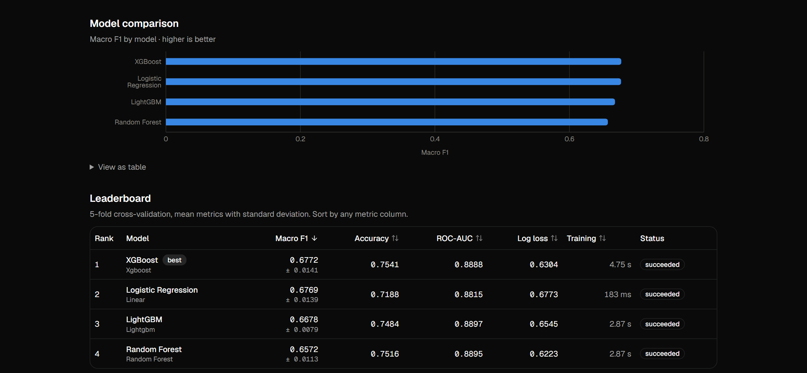
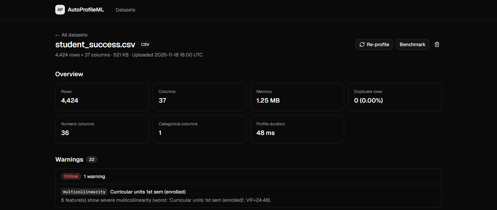
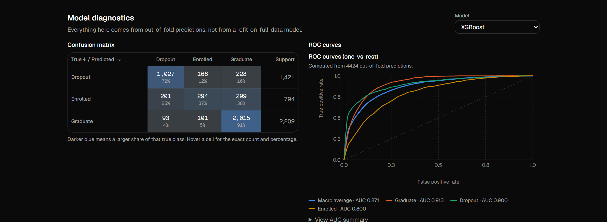
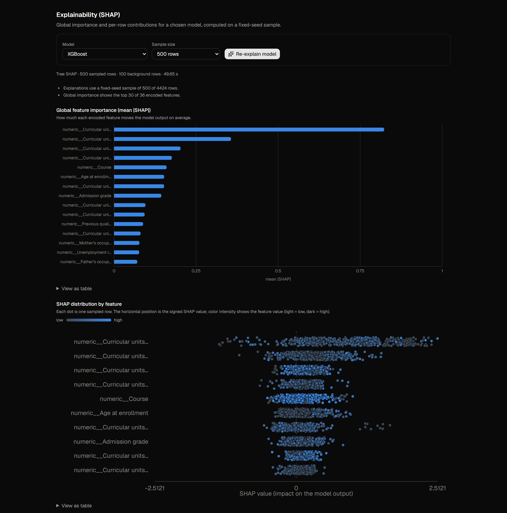
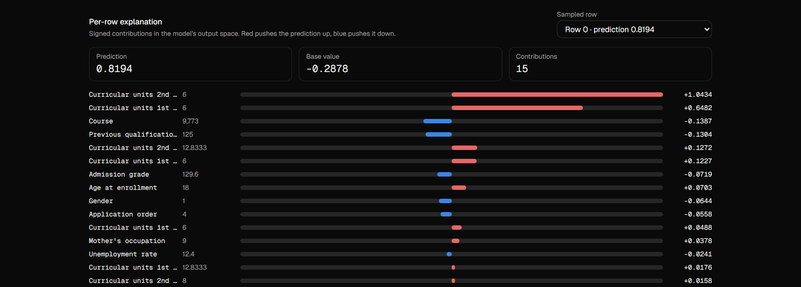
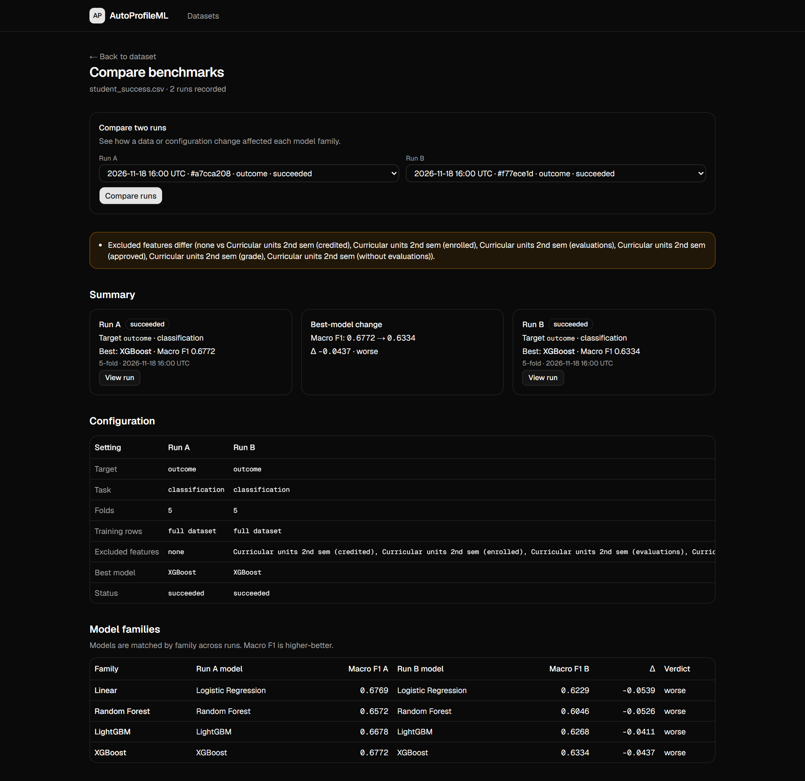
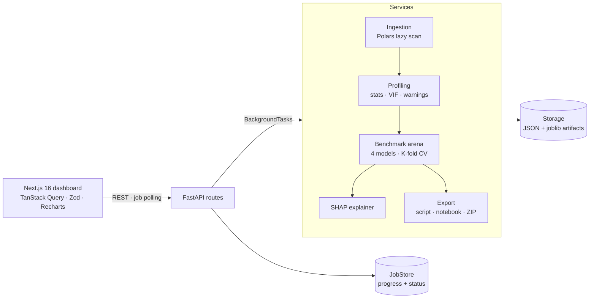
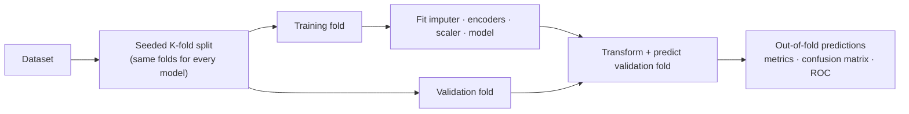

# AutoProfileML

[](https://github.com/Codeaholic10/AutoProfileML/actions/workflows/ci.yml)


**Transparent AutoML for tabular data.** Upload a CSV or Parquet file and AutoProfileML profiles
it, benchmarks four model families with leakage-free cross-validation, explains the winner with
SHAP, and exports a standalone training script you can run without the app.

Most AutoML tools hand you a model and hide how they got there. AutoProfileML shows every step:
which preprocessing was fitted where, how each model scored on identical folds, why the model
predicts what it does, and the exact code to reproduce it.



## Highlights

- **Fast profiling with Polars.** Per-column stats, missingness, skew/kurtosis, top values,
  duplicate detection, VIF multicollinearity and correlation, plus severity-tagged data-quality
  warnings. A 4,424 × 37 dataset profiles in about 50 ms of compute.
- **Leakage-free preprocessing.** Adaptive imputation (KNN or median, chosen per fold),
  one-hot and target encoding, IQR clipping and scaling all live inside one scikit-learn
  `Pipeline` that is refitted on every training fold. Nothing is fitted on the full dataset
  before splitting.
- **Fair benchmark arena.** Logistic/Ridge, Random Forest, LightGBM and XGBoost run on the
  *same* seeded folds (stratified for classification), ranked by task-aware metrics with
  fold standard deviations. Confusion matrices and ROC curves come from persisted out-of-fold
  predictions.
- **Explanations tied to the real model.** SHAP (Tree or Linear explainer) runs on the exact
  persisted pipeline: global importance, a beeswarm, and per-row contribution breakdowns, on a
  fixed-seed sample capped at 1,000 rows.
- **Reproducible export.** One click produces a ZIP with `train_model.py`, a matching Jupyter
  notebook, a README and the fitted pipeline. A test extracts the script and runs it in a
  clean process to prove it works standalone.
- **Run comparison.** Put two runs of the same dataset side by side, with per-family metric
  deltas and warnings when their configurations differ.

## Results

Evaluated on two public UCI datasets (credit default and student outcomes) with a stratified
80/20 hold-out. AutoProfileML ran 5-fold CV on the training split, and its persisted best model
scored the hold-out rows.

| Dataset | AutoProfileML (4 fixed models) | FLAML AutoML | H2O AutoML |
| --- | --- | --- | --- |
| Credit default (10k train rows) | **0.670** macro F1 · 19 s | 0.679 · 120 s budget | 0.701 · 30 s |
| Student outcomes (3.5k train rows) | **0.681** macro F1 · 31 s | 0.684 · 120 s budget | 0.702 · 41 s |

- Within **0.01 macro F1 of FLAML** in **4–6× less training time**. H2O's stacked ensembles
  lead by about 0.02–0.03; AutoProfileML trades that last bit of accuracy for transparency and
  reproducibility.
- Profiling took **about 1 s end to end, 10–13× faster than Sweetviz** on the same files,
  with zero difference from pandas across 400+ statistics.
- Reported CV metrics and SHAP importances match a direct scikit-learn/SHAP computation of the
  same pipeline to within **1e-6**.

## Screenshots

| Dataset profile | Model diagnostics (out-of-fold) |
| --- | --- |
|  |  |

| SHAP global importance and beeswarm | SHAP per-row explanation |
| --- | --- |
|  |  |



## Architecture



How each fold stays leakage-free:



Routes only validate input and call one service; services own the ML logic and never import
FastAPI; all persisted objects go through a `Storage` interface. The full design, API contract
and decision records are in [ARCHITECTURE.md](ARCHITECTURE.md).

## Tech stack

| Layer | Tools |
| --- | --- |
| Backend | Python 3.14, FastAPI, Pydantic v2, Polars, NumPy |
| ML | scikit-learn, LightGBM, XGBoost, SHAP, joblib |
| Frontend | Next.js 16 (App Router), React 19, TypeScript (strict), Tailwind CSS v4, shadcn/ui, TanStack Query, Zod, Recharts |
| Quality | pytest, Vitest, Testing Library, MSW, Ruff, mypy (strict), ESLint, GitHub Actions |

## Engineering practices

- Every push runs lint, format, strict type checks, the full test suites and a production
  build in GitHub Actions ([workflow](.github/workflows/ci.yml)).
- Backend tests use deterministic synthetic frames and isolated temporary storage; frontend
  tests mock the API with MSW and test what the user sees.
- Fixed random seed (`42`) for splits, models and SHAP sampling, so runs are reproducible.
- Long work (profiling, training, SHAP, export) runs as background jobs with progress
  reporting; one failing model never takes down the run.
- Uploads are validated for type, emptiness and size; filenames are sanitized; only
  server-written model files are ever unpickled.

## Quick start

Requires Python 3.11+ and Node.js 22+.

```bash
# Backend: http://localhost:8000 (OpenAPI docs at /docs)
cd backend
python -m venv .venv
source .venv/Scripts/activate        # Windows Git Bash; use .venv/bin/activate on macOS/Linux
pip install -e ".[dev]" -c constraints.txt
uvicorn app.main:app --reload --port 8000
```

```bash
# Frontend: http://localhost:3000
cd frontend
npm ci
npm run dev
```

Then open http://localhost:3000, upload a CSV or Parquet file, pick a target column and run a
benchmark.

### Checks

```bash
cd backend && bash scripts/check.sh        # ruff, ruff format --check, mypy, pytest
cd frontend && npm run lint && npm run typecheck && npm test && npm run build
```

## Configuration

Backend settings use the `AUTOPROFILEML_` prefix and can be set in `backend/.env`
(see [backend/.env.example](backend/.env.example)):

| Variable | Default | Purpose |
| --- | --- | --- |
| `AUTOPROFILEML_ENV` | `development` | Environment label |
| `AUTOPROFILEML_STORAGE_ROOT` | `./data` | Dataset, profile and artifact storage |
| `AUTOPROFILEML_MAX_UPLOAD_MB` | `200` | Maximum upload size |
| `AUTOPROFILEML_CORS_ORIGINS` | `http://localhost:3000` | Allowed frontend origins (comma-separated) |
| `AUTOPROFILEML_JOB_RETENTION_SECONDS` | `21600` | In-memory job retention (6 hours) |

The frontend reads `NEXT_PUBLIC_API_BASE_URL` (default `http://localhost:8000`) and
`NEXT_PUBLIC_MAX_UPLOAD_MB`. See [frontend/README.md](frontend/README.md).

<details>
<summary><strong>REST API</strong></summary>

| Method | Path | Description |
| --- | --- | --- |
| `GET` | `/health` | Health, version, environment |
| `POST` | `/api/datasets` | Upload CSV/Parquet and queue profiling |
| `GET` | `/api/datasets` | List datasets with profile/job state |
| `GET` | `/api/datasets/{id}` | Dataset metadata |
| `DELETE` | `/api/datasets/{id}` | Delete a dataset, its metadata and its profile (`204`) |
| `GET` | `/api/datasets/{id}/profile` | Stored profile (`409` while pending) |
| `POST` | `/api/datasets/{id}/profile` | Re-run profiling |
| `GET` | `/api/datasets/{id}/jobs` | Job history for a dataset |
| `GET` | `/api/jobs/{id}` | Poll a job |
| `POST` | `/api/datasets/{id}/benchmarks` | Queue a benchmark run for a target (`202`) |
| `GET` | `/api/datasets/{id}/benchmarks` | Benchmark history for a dataset |
| `GET` | `/api/benchmarks/{id}` | Run plus ranked leaderboard |
| `GET` | `/api/benchmarks/{id}/models/{model_id}/predictions` | Out-of-fold predictions (`400` for regression) |
| `POST` | `/api/benchmarks/{id}/explanations` | Queue a SHAP explanation (`202`) |
| `GET` | `/api/benchmarks/{id}/explanations/{model_id}` | Stored explanation (`404` until generated, `409` while the run is pending) |
| `POST` | `/api/benchmarks/{id}/exports` | Queue a standalone export bundle for a model (`202`) |
| `GET` | `/api/benchmarks/{id}/exports/{model_id}` | Bundle manifest (`404` until generated, `409` while the run is pending) |
| `GET` | `/api/benchmarks/{id}/exports/{model_id}/download` | Download the script + notebook + model ZIP |

</details>

<details>
<summary><strong>Troubleshooting</strong></summary>

- **Port already in use:** run Uvicorn on another port (`--port 8001`) and set
  `NEXT_PUBLIC_API_BASE_URL` to match.
- **Browser requests blocked by CORS:** add the frontend origin to
  `AUTOPROFILEML_CORS_ORIGINS` and restart the backend.
- **Uploads rejected:** only `.csv`, `.parquet` and `.pq` are accepted, up to
  `AUTOPROFILEML_MAX_UPLOAD_MB`. Empty files return `400`, oversized files `413`, unsupported
  types `415`.
- **Where did my data go?** Everything is under `AUTOPROFILEML_STORAGE_ROOT` (default
  `backend/data/` when running from `backend/`). It is gitignored.
- **Job disappeared after restart:** job progress is in memory by design; profiles, runs and
  artifacts persist on disk.
- **`ruff format` panics with a range error:** a file was saved with a UTF-8 BOM; re-save it
  as plain UTF-8 (`.editorconfig` enforces this).

</details>

## Current limitations and roadmap

This is a single-user MVP by design:

- Job progress lives in one process's memory, so the API runs as a single worker, and models
  train one after another inside a job.
- Data and artifacts are stored on local disk; there is no authentication or multi-tenancy.
- Jobs cannot be cancelled; exported `model.joblib` files need the backend package to unpickle
  (the generated script rebuilds a standalone pipeline instead). No ONNX export.
- Tabular CSV/Parquet only; no deep learning, time series or unstructured data.

Next steps: a Redis-backed job queue with separate workers and a concurrency cap, parallel
model training, streaming profiling for multi-million-row files, Docker Compose, and object
storage with per-user ownership.
